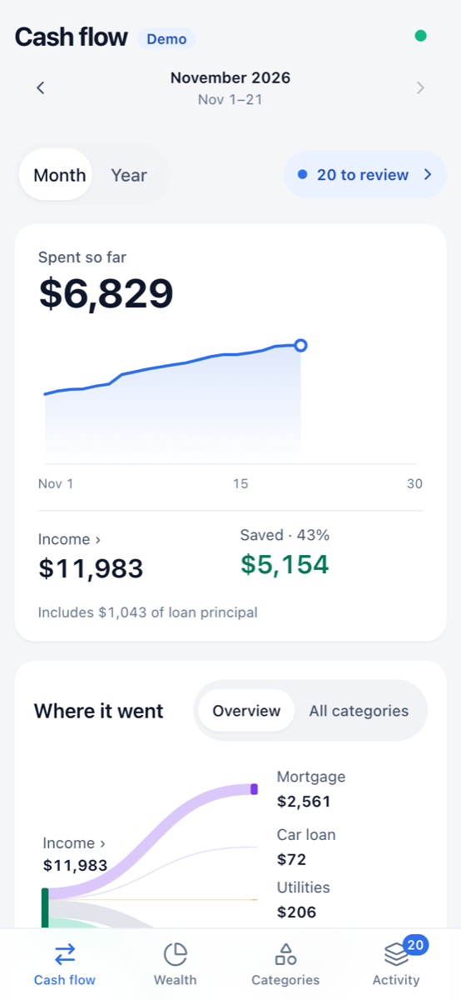
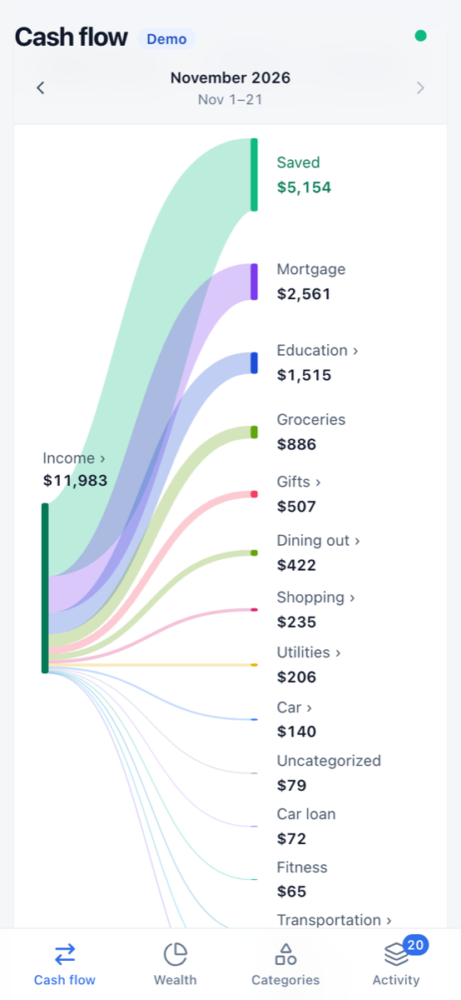
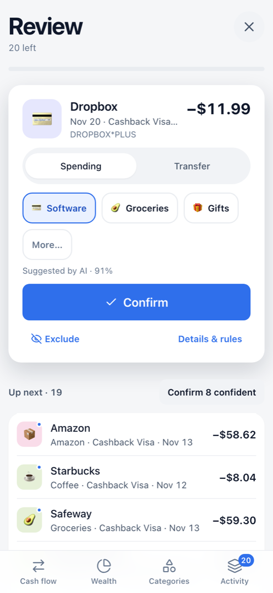
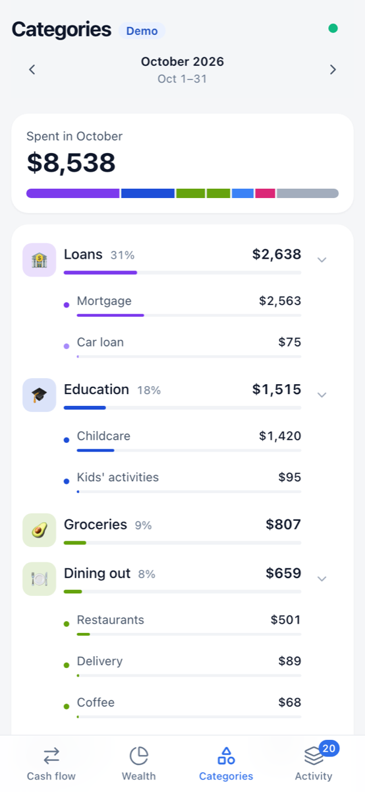
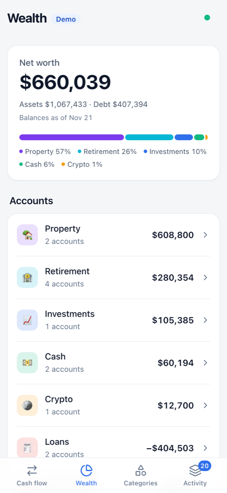
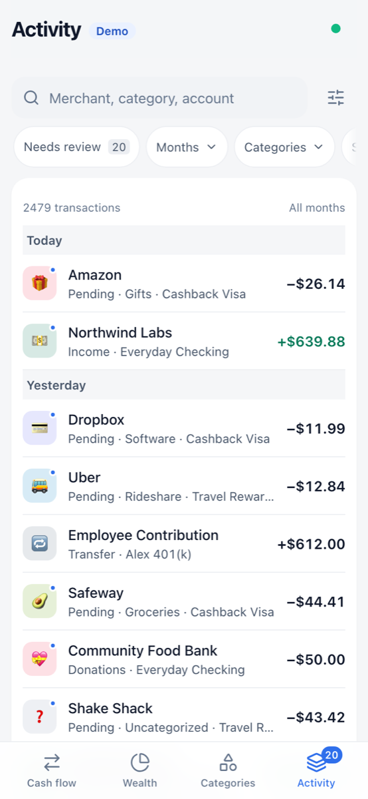

# Money

A phone-first household money app: monthly and yearly cash flow, net worth,
spending by category, and a review inbox that gets new transactions to zero fast.

**[Open the live demo →](https://sandeepgangarapu.github.io/money/)**

The demo runs entirely in your browser with a fictional household (Alex and Sam,
two jobs, a mortgage, a car loan and about 2,500 transactions over 30 months).
Every name, account and amount is made up. Reviews, category changes and rules
work, and reloading the page starts over.

| Cash flow | Where it went | Review |
| --- | --- | --- |
|  |  |  |
| **Categories** | **Wealth** | **Activity** |
|  |  |  |

## What it does

- **Cash flow:** spending so far with a running line you can scrub, income,
  saved and savings rate, and a Sankey of where the money went. Loan principal
  counts as saved, and merchant refunds reduce their category's spending.
- **Review inbox:** one card at a time with the AI suggestion and its
  confidence, one-tap categories, "Confirm N confident", swipe gestures and
  keyboard shortcuts (J/K, Enter, 1–3, E, X, ⌘Z).
- **Instant edits:** changes apply on screen immediately and save after a
  four-second undo window.
- **Categories:** each category's share of the month, with a detail sheet per
  category (year total, monthly average, transactions by month).
- **Wealth:** net worth, an allocation bar, accounts grouped by type, and a
  searchable list of holdings across accounts.
- **Activity:** search, filters and sorting across the full history.
- **Rules:** preview which past transactions a rule would match before applying it.

## How the demo works

All data goes through a single module, `src/data/transport.ts`. The normal
build sends requests to the app's backend. `npm run build:demo` swaps that
module for `src/demo/transport.ts`, which answers the same API in memory from a
generated household (`src/demo/household.ts`, seeded per month so the history
always ends on today). `npm run build` fails if demo data ever reaches the normal
bundle, and `tests/demo.test.cjs` checks that the demo's totals reconcile.

## Run it

Requires Node 22.12 or later.

```sh
npm ci
npm run dev:demo      # demo with the fictional household at http://localhost:5175
npm run check         # Biome lint and format
npm test              # node:test suites
npm run build:demo    # static demo site in dist-demo/
```

The normal build (`npm run build`) expects a backend serving
`/api/v1/money_dashboard`. The contract is in `src/data/api.ts`. The backend
used with this app is a private fork of [Sure](https://github.com/we-promise/sure)
and is not part of this repository.

## Stack

React 19, TypeScript, Vite, CSS Modules with a small token-based design system
(`src/index.css`, `src/components/Primitives.tsx`), d3-sankey and lucide-react.

## License

[AGPL-3.0](LICENSE). This app is built on top of
[Sure](https://github.com/we-promise/sure), which is licensed under the AGPL-3.0.
